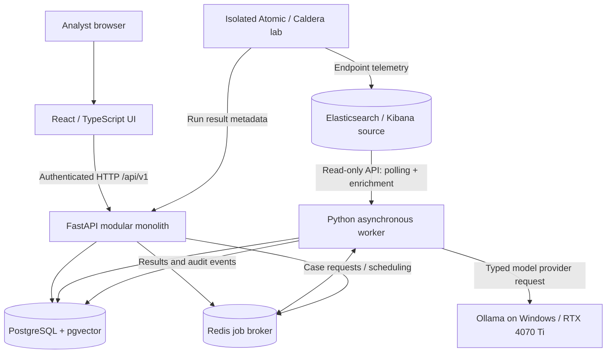
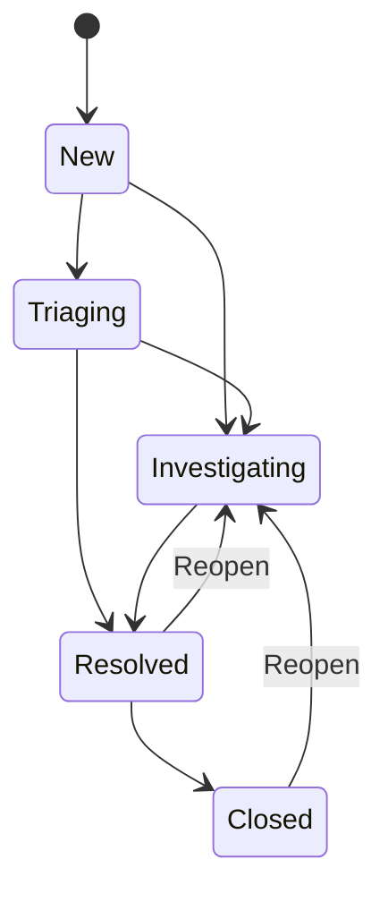
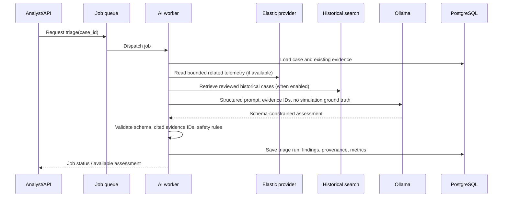

# SentinelForge — System Architecture

**Status:** Engineering baseline; Phase 2 implemented, later phases planned

**Document owner:** Project maintainers  
**Intended audience:** Codex, developers, reviewers, and future contributors  
**Scope:** Standalone, self-hosted security operations, case management, local AI triage, and purple-team validation platform  
**Companion document:** [`ROADMAP.md`](./ROADMAP.md)

> **Implementation rule:** Treat this document as the current technical design, not proof that a component already exists. If an implementation decision differs, document it in an Architecture Decision Record (ADR), update relevant tests, and amend this file before expanding that divergence. `AGENTS.md`, where present, governs day-to-day coding instructions.

---

## 1. Product intent and guiding principles

SentinelForge is a **standalone SOC workbench** that imports security alerts, groups related events into investigations, maintains analyst-reviewed case histories, enriches evidence, uses a **local** LLM for *advisory* triage, and validates detections against controlled adversary simulations.

The application **owns case data and workflows**; it does not replace Elasticsearch as a telemetry store or require Kibana as its user interface. Elasticsearch is the initial alert and event provider. Ollama is the first LLM runtime, not a hard-coded dependency.

### Design principles

1. **Application independence.** Case management must work with synthetic/manual alerts while Elasticsearch and Ollama are offline.
2. **Modular monolith first.** One FastAPI application with well-defined internal modules; separate background worker processes for time-consuming operations. Avoid microservice proliferation.
3. **Human authority over incidents.** AI-generated assessments are recommendations, never official case dispositions. The LLM must not automatically contain devices, close cases, disable rules, or run shell commands.
4. **Evidence before conclusions.** Every material claim in AI results must cite IDs in the evidence set or be explicitly marked an inference/unknown. Missing data is not proof of benign behavior.
5. **Provider abstraction.** New alert sources and LLM providers should be replaceable through typed adapters, without modifying case/domain logic.
6. **Recoverable local operation.** `docker compose up -d` and `docker compose down` should work without losing durable state. Downtime for the local LLM or application should not silently lose alert ingestion progress or queued investigation jobs.
7. **Measurable engineering.** Every phase has automated tests and a demonstrable vertical slice; purple-team execution must be separately measured from telemetry capture, rule detection, and AI classification.
8. **Security by default.** Explicit service identities, least privilege, network segmentation, controlled test targets, bounded log/prompt inputs, and auditability.

### In scope for v1

- Browser-based SOC dashboard and investigation workspace.
- Manual/synthetic alert import and one production-quality **Elastic Security** adapter.
- Alert ingestion, deduplication, case linkage, evidence references and snapshots.
- Case ownership, status transitions, analyst notes, disposition, and audit history.
- Asynchronous LLM triage through an Ollama-compatible provider abstraction.
- Historical case search (structured/full-text first, vector similarity later).
- Controlled local purple-team test registry, execution tracking, and detection validation.
- Detection rule repository and validation workflow; deployment only after approval.
- Start/stop local development with persistent storage, health checks, tests, and documentation.

### Explicit non-goals for the first version

- Replacing a commercial SIEM, EDR, or SOAR platform.
- Unrestricted autonomous security remediation or LLM shell access.
- A distributed multi-tenant SaaS, high-availability production cluster, or Kubernetes deployment.
- Automatic live exploitation of internet-facing hosts or systems without authorization.
- Real-time processing guarantees while the PC is off or Ollama is unloaded.
- Fine-tuning an LLM before a labeled evaluation set exists.
- Treating synthetic simulation labels as information visible to the triage model.

---

## 2. Target deployment and resource constraints

### Primary development computer

| Resource | Current target |
|---|---|
| Operating system | Windows 11 |
| System memory | 32 GB DDR5 |
| GPU | NVIDIA RTX 4070 Ti, assumed 12 GB VRAM (verify exact card) |
| Free disk at planning | Approximately 611 GB |
| Application orchestration | Docker Desktop using WSL2 backend and Docker Compose |
| GPU inference | Native Windows Ollama, started on demand |
| Target model | Quantized Qwen family model, starting with an 8B–9B-class candidate subject to VRAM benchmark |

**Practical limits:** Run one model at a time, cap worker concurrency and inference context, and avoid simultaneous large Elastic indexing loads and multiple Windows VMs on the 32 GB desktop. Reserve substantial free SSD capacity; application stores must have documented retention rules. Treat model sizes and memory allocation as measured settings, not guarantees.

### Optional remote attack lab

The user's Dell PowerEdge R620 has **dual Xeon E5-2640 v2 CPUs, 160 GB RAM, PERC H710P Mini RAID, and four 1 GbE interfaces**. It can run Proxmox, isolated Windows/Linux targets, Active Directory, and Caldera/Atomic Red Team. It is not required for frontend/backend development. Prefer using the RTX 4070 Ti desktop for LLM inference; the older R620 CPUs are inefficient for substantial CPU-only model inference.

### Deployment modes

- **Local-only / development:** Docker Compose hosts web, API, worker, PostgreSQL, Redis, and optionally Elasticsearch/Kibana. Ollama runs on Windows; test data may be synthetic. Entire application is start/stop on demand.
- **Hybrid lab:** The app and Ollama run on desktop; Elastic and isolated simulation endpoints may run on R620. Use a read-only Elastic account for source telemetry and explicit network/firewall rules.
- **Degraded / offline:** Cases remain usable if Elasticsearch is offline; existing evidence snapshots and historical cases remain available. If Ollama is offline, triage jobs remain pending or retry later. If the desktop is off, no local application or worker executes; resumed jobs catch up only if the remote source has retained the data.

### Logical topology



**Important:** This is a *logical* flow, not an invitation to grant wide network access. Attack-lab targets must not be able to reach PostgreSQL, Redis, Ollama, or the developer's management interfaces directly.

---

## 3. Component architecture

### 3.1 Web app (`apps/web`)

- React + TypeScript + Vite; Tailwind CSS and an accessible component library.
- Phase 0 selects shadcn/ui and TanStack Query; the product UI uses ATÉ with a modern, clean, cybersecurity-focused theme. See [ADR 0002](ADR/0002-frontend-foundation.md).
- Feature modules: SOC overview, alert queue, case detail/workspace, evidence timeline, AI triage review, historical library, detection lab, admin/integrations.
- TanStack Query or equivalent for server state. React state for ephemeral UI; backend/database own authoritative state.
- Route examples: `/cases`, `/cases/:caseId`, `/alerts`, `/investigations/:id`, `/detections`, `/simulations`, `/settings`.
- Phase 2 implements `/`, `/cases`, `/cases/:id`, `/alerts`, `/alerts/:id`, and `/system` with React Router and a complete shadcn redesign; later route examples remain proposals. See [ADR 0005](ADR/0005-phase-2-local-case-workspace.md).
- Never embed Elastic, Ollama, PostgreSQL, or Redis credentials in browser code. The browser calls only the backend.
- Display provenance and status clearly: analyst-confirmed disposition vs. AI recommendation vs. simulated ground truth.

### 3.2 API (`apps/api`)

FastAPI contains independently testable **domain modules**:

| Domain | Responsibility |
|---|---|
| `identity` | Development authentication initially; RBAC and OIDC integration path |
| `cases` | Create, assign, update, reopen, resolve, close, merge/split |
| `alerts` | Normalize/import alerts, deduplicate, link to cases |
| `evidence` | Event snapshots, pointers, hashes, timeline, provenance |
| `correlation` | Deterministic case-link suggestions and explanations |
| `triage` | Request AI assessments, validate outputs, collect review feedback |
| `search` | Structured, full-text, and vector-based historical queries |
| `detections` | Rule metadata, versioning, validation results, approvals |
| `simulations` | Allowed test catalog, execution manifests, validation reports |
| `audit` | Append-only record of significant state changes |
| `integrations` | Provider configuration, connection health, incremental cursors |

Keep Pydantic API schemas separate from SQLAlchemy persistence models and from service/domain logic. Business rules must be exercised without requiring a running browser or real LLM.

### 3.3 Worker (`apps/worker`)

Use a Redis-backed task system (choose **RQ or Celery** and document the ADR; don't introduce both). The worker performs:

- Scheduled/paginated Elastic polling, resilient cursor advancement.
- Alert enrichment and bounded evidence retrieval.
- Correlation suggestions and deduplication checks.
- AI triage orchestration, backoff, and timeouts.
- Embedding generation and historical retrieval index updates.
- Simulation-result correlation, rule validation, and report generation.

**Queue design:** Task payloads contain IDs, not full unbounded evidence; records live in PostgreSQL. Use per-type queues (`ingestion`, `triage`, `indexing`, `validation`) and start with a single GPU-intensive triage job at a time. Persist job state and retry count in the database because Redis alone must not be the sole record of work. Jobs must be idempotent, with bounded retries and dead-letter/error visibility.

### 3.4 PostgreSQL (`postgres`)

PostgreSQL is authoritative for cases, imported alert metadata, evidence snapshots, investigator decisions, audit trails, job metadata, and historical case records. Use Alembic migrations. `pgvector` is introduced only when semantic retrieval is added; start with relational and full-text search.

### 3.5 Elasticsearch (`elastic` provider)

Elasticsearch is authoritative for source telemetry and its original detection alerts. SentinelForge reads via authenticated Elasticsearch APIs using a **least-privilege read-only API key**. Initial mode: incremental polling; webhook integration is optional later and depends on available connector capabilities.

Read supported Elastic Security alert aliases (for example `.alerts-security.alerts-default` for the default space), and use supported documented APIs. Do **not** modify Elastic-managed alert mappings or rewrite source alerts. Additional Kibana spaces, alert schemas, and privileges are tested explicitly before use.

Store the source provider, space/index reference, upstream alert identifier, event timestamp, import timestamp, and a bounded normalized snapshot. Keep raw sensitive fields out of application logs.

### 3.6 Ollama / model provider

Ollama is a local REST inference runtime. Qwen is the model family, not a separate competing server. Integrate through an adapter such as:

```python
class ModelProvider(Protocol):
    async def health_check(self) -> bool: ...
    async def generate_structured(self, messages: list[dict], schema: dict) -> dict: ...
```

The runtime is external to Compose on the primary Windows host. From containers, use a configured host gateway (commonly `host.docker.internal`, subject to verification). Bind Ollama only to interfaces needed for the application, firewall it to allowed sources, and never make its unauthenticated API internet-facing. An authenticated reverse proxy or network tunnel may be appropriate in hybrid deployments.

Recommended settings for desktop inference: one concurrent request, bounded token/context budget, short model idle unload, and request timeouts. **Do not assume a particular model fits or performs well until measured on the 12 GB GPU.** Model name, quantization, version, prompt version, context size, and inference measurements must be retained per triage run.

---

## 4. Source-control and repository layout

```text
sentinelforge/
├── AGENTS.md                        # Codex instructions, if present
├── README.md
├── .env.example                     # Placeholder config only; no secrets
├── compose.yaml
├── compose.dev.yaml
├── apps/
│   ├── web/                         # UI, routes, components, API client
│   ├── api/
│   │   └── sentinelforge/
│   │       ├── main.py
│   │       ├── core/                # Config, auth, DB session, errors
│   │       ├── domains/             # cases, alerts, evidence, triage, etc.
│   │       ├── providers/           # elastic, ollama, fake providers
│   │       └── db/                  # SQLAlchemy models and migrations
│   └── worker/                      # Background job entrypoints
├── packages/
│   ├── contracts/                   # OpenAPI/generated client or shared schemas
│   └── detection-rules/             # Version-controlled rules and fixtures
├── infrastructure/                  # Compose override templates, configs
├── tests/
│   ├── fixtures/                    # Sanitized, synthetic alerts/evidence
│   ├── integration/
│   ├── e2e/
│   └── evaluation/                  # Labeled triage benchmark dataset
└── docs/
    ├── ARCHITECTURE.md
    ├── ROADMAP.md
    ├── ADR/                         # Architecture Decision Records
    ├── API.md
    ├── DATA-MODEL.md
    ├── THREAT-MODEL.md
    └── RUNBOOK.md
```

**Contract policy:** Define the API in FastAPI/Pydantic, export OpenAPI, and generate or validate the frontend types from it. Avoid maintaining two divergent hand-written representations of the same API.

---

## 5. Data model and invariants

### 5.1 Core tables

| Table | Key fields / purpose |
|---|---|
| `users` | ID, handle, role, active state; authentication source |
| `cases` | UUID PK, display ID, title, severity, status, disposition, owner, optimistic-lock version, timestamps |
| `alerts` | UUID PK, provider, source unique ID, rule ID, host/user identifiers, event/import time, severity, normalized snapshot |
| `case_alerts` | Many-to-many association; correlation method, reason, actor, linked time |
| `evidence` | UUID, source event reference, case ID, event time, acquisition time, normalized excerpt, hash, sensitivity classification |
| `case_notes` | Author, case ID, body, created/edited timestamps; retained revision trail |
| `case_events` | Append-only audit: actor/service, action, prior/new state, correlation ID, timestamp |
| `triage_runs` | Case ID, job ID, model/provider/version, prompt version, state, timing, output, evaluation metadata |
| `triage_findings` | Claim, assessment ID, supporting evidence IDs, reasoning/limitations |
| `analyst_reviews` | Reviewer, triage run, judgment, corrections, created time |
| `integration_cursors` | Provider, scope, last committed cursor/watermark, last successful sync, failure state |
| `jobs` | Task type, target ID, status, attempt count, idempotency key, last error |
| `case_embeddings` | Case ID, embedding model version, vector, canonical text hash, review eligibility |
| `simulation_runs` | Test ID, technique ID, authorized target, start/finish, executor status, telemetry expectation |
| `detection_results` | Simulation, rule, expected/observed event refs, verdict, reasoning |
| `detection_rules` | Canonical rule ID, version, language, data requirements, approval status |

### 5.2 Important invariants

- Every case has an internal UUID and an immutable, human-readable ID (e.g., `SF-2026-000142`).
- `UNIQUE(provider, provider_scope, external_alert_id)` prevents duplicate imports. Re-ingestion may refresh mutable metadata but must not create a second alert.
- Cases and alerts have a many-to-many relationship; link/unlink actions are audited.
- `case.status` and `case.disposition` are distinct. An AI classification must not write to an analyst's disposition field.
- Evidence source IDs, acquisition times, hashes, and provenance are retained; evidence may be unavailable at the upstream provider after retention expiry, so store bounded snapshots subject to data policy.
- Source timestamps and ingestion timestamps remain distinct and normalized to UTC.
- Every AI finding has known evidence IDs or is marked as unsupported/uncertain; code validates the IDs against the submitted evidence package.
- Closed cases may be reopened. Merge/split operations preserve associations and audit provenance rather than silently deleting records.
- Deletion uses explicit retention/tombstone policy with audit logging; don't hard-delete closed cases by default.
- Historical case embeddings are tied to an embedding model version and can be reindexed deterministically.

### 5.3 Case state machine



Initial dispositions: `true_positive`, `benign_positive`, `false_positive`, `inconclusive`. Status transitions need service-side validation, role checks (when auth exists), and append-only audit events.

---

## 6. Primary application workflows

### 6.1 Ingest → correlate → investigate

1. Worker requests alert batches from provider using a persisted cursor/watermark with a small overlap window for eventual consistency.
2. Normalize to a provider-independent `AlertCreate` contract; reject/record malformed records without blocking the entire batch.
3. Upsert alert using the source unique key; commit ingestion cursor only after durable inserts and job scheduling are committed.
4. Match known alerts/cases by deterministic, explainable signals: source event ID, host, user, process entity ID, rule family, and bounded time window. Avoid auto-merging on just host name and timestamp.
5. Create a new case or **suggest** attachment to an existing one according to explicit policy; track the correlation explanation and whether a human confirmed it.
6. Enrichment job queries related telemetry under fixed limits (time window, field set, document count, byte budget) and stores referenced snapshots.
7. UI exposes case, alerts, evidence timeline, analyst notes and clear source/provenance links.

### 6.2 AI investigation



**Prompt/evidence contract:**

- System prompt: role and safety boundaries; retrieved logs and historical cases are **untrusted data**, never instructions.
- Evidence input: normalized snippets with stable IDs, source, event time, bounded content, and explicit omissions.
- Output: `classification` (`suspicious|likely_benign|inconclusive`), `severity`, `summary`, `findings[{claim,evidence_ids}]`, `missing_evidence`, `recommended_actions`, `requires_human_review`.
- Validate with Pydantic/JSON Schema. Unsupported evidence references fail validation and require regeneration or analyst review; do not silently invent or replace IDs.
- Triage run must be reproducible from stored prompt template version, sanitized evidence snapshot, retrieval IDs, model/quantization details, and generation parameters, subject to data retention.
- Store latency, completion status, retries, and validation failures; abstention is a valid result.
- Restrict AI tools to allowlisted, read-only query functions with fixed scope. No arbitrary SQL, unrestricted KQL, code execution, rule deployment, or active containment.

### 6.3 Historical retrieval and analyst feedback

- Index only **reviewed, sufficiently complete** cases for model context by default. Store which records were eligible and why.
- First retrieve using exact filters (rule IDs, source, host/user/process indicators where appropriate, ATT&CK mapping, disposition) and Postgres full-text search.
- Later add `pgvector` for semantic nearest-neighbor search, with a **separate embedding model** (not necessarily the triage model) and canonical summary format.
- Rank with both lexical and semantic evidence; cap top-K and prompt token budget.
- Return previous case IDs, review state, key similarities, key differences, and original analyst disposition. Never auto-close a new case because a similar historical case was benign.
- Maintain a frozen labeled test set for offline precision/recall, hallucination/citation quality, and retrieval relevance; don't score a model against its own past predictions.

### 6.4 Purple-team validation

- Only allow approved simulations against an **isolated test allowlist**. Execution service enforces target, test ID, and operator authorization; cleanup and timeouts are mandatory.
- Registry stores ATT&CK technique, prerequisites, target, executor, safety classification, expected telemetry, expected rule, and expected observations.
- Run produces immutable execution metadata and ground truth for evaluation **not visible to the triage model**.
- Correlate raw telemetry and detection alerts separately. Classify outcomes as:
  - `passed`: executed + telemetry observed + expected alert observed;
  - `detection_gap`: executed + telemetry observed + expected alert missing;
  - `telemetry_gap`: executed but prerequisite telemetry missing;
  - `invalid_test`: executor/prerequisite failed;
  - `inconclusive`: insufficient evidence.
- Store evidence IDs, rule versions, ingestion delays, and test windows. Record false positives from benign control runs. Expose detection latency and coverage over valid tests.

### 6.5 Detection Engineering as Code

- Rules live in Git with stable IDs, revision history, ATT&CK mapping, required fields/data sources, rationale, and labeled test fixtures.
- CI checks schema/syntax, executes rule-query tests against labeled datasets, and reports expected positives/negatives.
- Rule promotion requires explicit analyst approval; deploy to Elastic using supported Kibana APIs and restricted credentials, not by writing internal alert indices.
- Retain deployment history and rollback mechanism. AI-proposed rules are always untrusted drafts.

---

## 7. API surface and contracts

Version APIs from day one: `/api/v1`. Use resource identifiers, consistent validation/errors, pagination, filtering, and authorization enforcement on the server.

| Method | Endpoint | Purpose |
|---|---|---|
| `GET` | `/api/v1/health` | Service health (non-sensitive) |
| `GET/POST` | `/api/v1/cases` | List/create cases |
| `GET/PATCH` | `/api/v1/cases/{case_id}` | View/update case |
| `POST` | `/api/v1/cases/{case_id}/transitions` | Validated state changes |
| `GET/POST` | `/api/v1/cases/{case_id}/notes` | Analyst notes |
| `GET/POST` | `/api/v1/cases/{case_id}/alerts` | List/link alerts |
| `GET` | `/api/v1/cases/{case_id}/timeline` | Case events and evidence timeline |
| `GET` | `/api/v1/alerts` | Imported normalized alert queue |
| `GET` | `/api/v1/alerts/{alert_id}` | Alert detail with source refs |
| `POST` | `/api/v1/cases/{case_id}/triage-runs` | Queue an AI investigation |
| `GET` | `/api/v1/triage-runs/{run_id}` | Job status, result, citations |
| `POST` | `/api/v1/triage-runs/{run_id}/reviews` | Analyst feedback |
| `GET` | `/api/v1/cases/search` | Structured/historical search |
| `GET` | `/api/v1/integrations` | Connection state (sanitized) |
| `POST` | `/api/v1/simulations/runs` | Authorized controlled test request |
| `GET` | `/api/v1/simulations/runs/{run_id}` | Ground truth and detection validation |
| `GET/POST` | `/api/v1/detection-rules` | Rule catalog / draft rules |

Reserve actual schema definitions to `docs/API.md` and generated OpenAPI. Do not mistake this candidate endpoint inventory for implemented routes.

### Provider contracts (illustrative)

```python
class AlertProvider(Protocol):
    async def fetch_alerts(self, cursor: str | None, limit: int) -> AlertBatch: ...
    async def fetch_evidence(self, alert: NormalizedAlert, limits: EvidenceLimits) -> list[EvidenceItem]: ...
    async def health_check(self) -> ProviderHealth: ...

class ModelProvider(Protocol):
    async def health_check(self) -> ProviderHealth: ...
    async def generate_structured(self, request: TriageRequest) -> TriageResponse: ...
```

A `FakeAlertProvider` and `FakeModelProvider` with deterministic fixtures are required for unit/integration tests and offline development.

---

## 8. Security model and trust boundaries

### Trust boundaries

1. **Browser → API:** Untrusted client; authenticate, authorize, validate input, and enforce rate limits.
2. **API/worker → PostgreSQL/Redis:** Private service network only; least privilege, credentials in environment secrets, no public published ports by default.
3. **Worker → Elastic:** Read-only query access with bounded scopes and no write privilege to source alerts.
4. **Worker → Ollama:** Untrusted evidence sent to inference; model output is untrusted until schema and provenance validation. Restrict the network endpoint to the local application/host.
5. **Attack lab → telemetry:** Lab hosts may emit events toward controlled collectors; they must not have administrative access to the application, Ollama, database, or home LAN.

### Baseline controls

- Never commit `.env`, API keys, Elastic credentials, database dumps, or unredacted event samples.
- Use synthetic/sanitized fixtures in Git. Classify stored evidence, redact credentials/tokens/PII when possible, and specify retention by dataset.
- Protect analyst actions via sessions/CSRF defenses as appropriate, server-side RBAC, and append-only audit events.
- Do not render raw event content as HTML. Escape log text and sanitize any Markdown rich text.
- Validate model outputs against strict schema and evidence IDs; log parsing must not execute code.
- Avoid command execution through user-controlled strings; simulation execution stays in an isolated, allowlisted subsystem.
- Apply dependency pinning, vulnerability scanning, container non-root users where practical, and read-only filesystem permissions as appropriate.
- Require HTTPS/authenticated tunnel for remote lab communication beyond the trusted development host.
- For Windows Ollama, configure firewall rules; avoid exposing `0.0.0.0:11434` beyond allowed clients, and never port-forward it publicly.

**Threat-model deliverable:** `docs/THREAT-MODEL.md` should cover prompt injection through alert bodies, forged evidence, poisoned historical cases, insecure provider credentials, malicious simulation content, privilege escalation, and data exfiltration.

---

## 9. Reliability, performance, and lifecycle

### On-demand operation

- Compose starts/stops application services; Ollama may remain installed natively and load/unload its model per demand.
- Use **named Docker volumes** or documented bind mounts for PostgreSQL, Redis persistence if used, and Elastic data. `docker compose down` must preserve them; `down -v` is destructive.
- Startup handles a partially unavailable provider gracefully. Readiness should distinguish core app availability from optional Elastic and Ollama availability.
- Resume polling from durable cursor after restart; use overlap, idempotency, and eventual reconciliation to avoid lost/duplicated alerts.
- Show a conspicuous status when inference is paused/offline and do not claim that triage runs have completed.

### Resource controls

- Start with conservative Elasticsearch JVM heap and bounded local index retention; expand only after observing load.
- Keep fewer than ~200 GB initially budgeted for all project datasets; not a hard quota until explicit controls are configured.
- Set worker concurrency per job class; GPU triage concurrency = 1 by default.
- Cap alert enrichment queries by number of documents, byte size, time window, and execution timeout.
- Keep per-case evidence size predictable; separate raw telemetry from curated evidence excerpts.

### Observability

- Structured JSON logs for API and worker with `request_id`, `job_id`, `case_id`, and `provider` where applicable; never log secrets or entire LLM evidence prompts by default.
- Metrics: alert ingest lag, duplicates prevented, queue length, enrichment latency, LLM inference time, failed validation counts, case resolution times, test coverage, and AI evaluation results.
- Health checks for API, DB, Redis, Elastic, and Ollama; treat optional dependencies as degraded status rather than total API failure.
- Recovery exercises: restart worker during active job, power down Ollama during triage, disconnect Elastic during polling, restore database backup.

### Data retention and backup

Document retention separately for source telemetry, imported alert metadata, evidence snapshots, case history, model prompts/results, embeddings, and simulation artifacts. Cases should outlive typical source-event retention without implying infinite raw-log storage. Implement PostgreSQL logical backups and *tested restores*. Do not rely on Docker volume persistence as backup.

---

## 10. Testing strategy and engineering quality gates

| Test layer | What to verify |
|---|---|
| Unit | Case transitions, deduplication keys, correlation scoring, AI schema validation |
| Contract | Provider adapters against deterministic fixtures, API OpenAPI compatibility |
| Integration | Real PostgreSQL/Redis; migrations; queue retry/idempotency; optional Elastic fixture integration |
| E2E | Browser creates/updates/resolves case; alert appears; triage report displays cited evidence |
| Fault injection | Ollama offline, Elastic unavailable, timeout during ingestion, duplicate delivery, worker restart |
| Security | Authorization, secret leakage, injected log content, unsafe AI tool requests, evidence tampering |
| Evaluation | Labeled AI cases: precision/recall, abstention, unsupported claim rate, citation validity |
| Detection | Valid attack execution vs. telemetry and alert presence; benign control false positives |

Use formatting, type checks, migration checks, and automated tests in CI. Add deterministic seeded demo data so fresh installations demonstrate the main UI without requiring an attack environment.

### Minimum initial acceptance test

```text
Seed synthetic alert
  → import and deduplicate
  → create/link case
  → inspect evidence in UI
  → add note
  → transition to Resolved with analyst disposition
  → verify append-only audit history
  → restart services
  → all records still present
```

This **vertical slice** is the first milestone before real Elastic, Ollama, and purple-team automation.

---

## 11. Architectural decisions still to record

Phase 0 decisions are recorded in [ADR 0001](ADR/0001-phase-0-foundation.md)
and [ADR 0002](ADR/0002-frontend-foundation.md): Celery/Redis, local-only access,
empty migration baseline, core/optional health semantics, resource ceilings,
contract generation, and the frontend component system. The remaining items
below stay subject to their phase review. See [Phase 0 status](PHASE_0_STATUS.md)
for measured validation versus unverified deployment criteria.

[ADR 0003](ADR/0003-optional-provider-configuration.md) makes the Elastic URL
optional (omitted or blank) while retaining configurable native Ollama/Qwen
settings. Neither provider is contacted by the application through Phase 2; their
availability does not affect core readiness.

Before implementation expands, create short ADRs for:

1. **Domain persistence (adopted):** case ID allocation, transition/disposition rules, audit immutability, optimistic locking, and separate migration/runtime database privileges are implemented in [ADR 0004](ADR/0004-phase-1-domain-persistence.md) and [DATA-MODEL.md](DATA-MODEL.md). Actual validation is in [PHASE_1_STATUS.md](PHASE_1_STATUS.md).
2. **Local access and routing (adopted):** Phase 2 uses a server-selected local analyst, loopback Host/Origin limits and write protection, plus React Router routes (ADR 0005). Multiuser authentication/RBAC/OIDC remains mandatory before widening access.
3. **Elastic compatibility:** tested version range, alert index aliases, source permissions, and schema normalization (Phase 3).
4. **Worker durability:** Celery crash/retry behavior, durable PostgreSQL job state, and idempotency (Phase 4).
5. **Model profile:** quantized Qwen model, context/window, Ollama settings, and observed RTX 4070 Ti benchmarks (Phase 4).
6. **Embeddings:** embedding model selection, schema, eligibility for historical retrieval, and model migration (Phase 5).
7. **Evidence policy:** Phase 1 adopts bounded snapshots, verified hashes, sensitivity labels and retention without automatic deletion (ADR 0004). Automatic redaction, retention schedules and export controls remain open before real sensitive data.
8. **Simulation isolation:** approved hosts/networks and executor authorization (Phase 6).

Do not block the initial case-management vertical slice on decisions about Caldera, embeddings, or future integrations.

---

## 12. Implementation sequencing

Implement **Phase 0 → Phase 1 → Phase 2** from [`ROADMAP.md`](./ROADMAP.md) before integrating external systems. These phases produce the app's durable core and the vertical-slice acceptance test. Then add Elastic ingestion, Ollama-backed investigations, historical case retrieval, simulation validation, and detection CI/CD in sequence.

**North-star invariant:** Even with Elasticsearch offline, Ollama unloaded, and no attack lab attached, an analyst must be able to open SentinelForge, review saved evidence, manage investigations, and trust the recorded case history.
