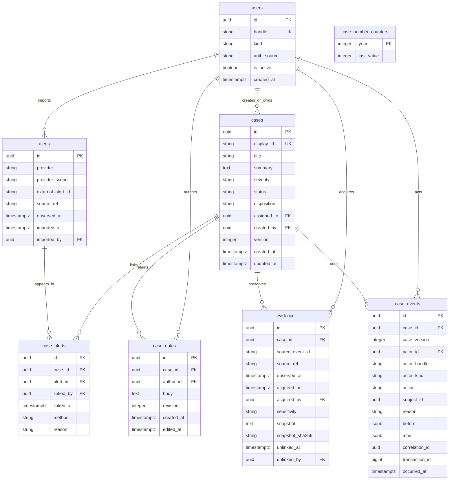

# Phase 1 data model

PostgreSQL is the source of truth. Alembic revision
`0002_domain_persistence` creates the eight domain tables below; the existing
`alembic_version` table continues to track migrations. There are no triage,
embedding, integration-cursor, simulation or detection tables yet.
See [ADR 0004](ADR/0004-phase-1-domain-persistence.md) for decisions and
[RUNBOOK.md](RUNBOOK.md) for migration/test commands.

The ERD lists core fields. Alerts also store title, severity, optional rule ID,
host/user identifiers and a bounded summary. Evidence also stores provider and
provider scope. Foreign keys restrict deletion; no cascade silently removes
history. Indexes cover case status/update time, assignment, alert event time,
alert-to-case lookup, case note/evidence timelines and audit actor lookup.
The unique `(case_id, case_version)` index orders the audit timeline.

## Invariants

- Internal UUID and human display ID are distinct. Display IDs use the database
  UTC transaction year and a concurrent-safe yearly counter; committed identity
  and creation provenance cannot be edited. Counters are internal allocation
  state, not case entities or an API resource.
- Alert source uniqueness includes provider scope. Importing the same source
  twice returns the first row without overwriting it. Identifiers are trimmed,
  otherwise case-sensitive; a future adapter owns source normalization.
- `case_alerts` has a unique `(case_id, alert_id)` pair. The same alert can
  belong to multiple cases. Unlink/relink creates a new active association and
  retains the previous association metadata/reason in immutable events.
- Status is `new`, `triaging`, `investigating`, `resolved` or `closed`.
  Disposition is nullable while open, mandatory when resolved/closed, and one
  of `true_positive`, `benign_positive`, `false_positive`, `inconclusive`.
  Only active human actors can resolve/close; reopening returns to
  `investigating` with no current disposition. Prior conclusions remain in
  audit. There is no AI classification field in a case command.
- Every case command advances its optimistic version exactly once and writes
  one audit event in the same outer transaction. Every child command also
  claims the case version. Callers must reload after a conflict; they must not
  retry with a guessed version. Deferred database checks run at outer commit.
- A failed command's savepoint restores its writes/version claim. The outer
  caller can catch a domain error and continue, or roll back the complete
  investigation transaction. Services never commit implicitly. After a failed
  command, reload ORM objects before accessing data expired by rollback.
- Notes have a current body and increasing revision. `note_added` and
  `note_edited` events preserve original/revised bodies; edits never replace
  the author. Evidence content/provenance are immutable. Unlinking evidence
  removes it from the active set without deleting its snapshot or audit trail.
- Evidence without a snapshot has no snapshot hash. A snapshot, including an
  empty string, has a verified SHA-256 digest of its exact UTF-8 bytes.
- Source event time is distinct from import/acquisition time. Timestamps use
  PostgreSQL `timestamptz`; transaction timestamps may be equal within one
  command batch, so case version defines deterministic audit order.
- Logs, notes, snapshots and source references are untrusted. Text limits are
  UTF-8 byte budgets; null bytes and unknown schema fields are rejected.
  There is no automatic purge/redaction or evidence-fetching behavior.

## Internal boundary for Phase 2

Use `CaseService(session, actor_id, correlation_id)` inside a caller-owned
`session_factory(engine).begin()` block. Its commands are `create_case`,
`update_details`, `assign`, `transition`, `import_alert`, `link_alert`,
`unlink_alert`, `add_note`, `edit_note`, `add_evidence`, and `unlink_evidence`.
All case mutations after creation require the expected case version.
Creation/import/link/evidence work may use active service actors. Analyst
notes, resolution and closure require active humans; note edits require the
same author. Actor identity must come from trusted server context in Phase 2.

Pydantic inputs are separate from SQLAlchemy models. Recoverable errors are
`NotFound`, `Conflict`, `InvalidTransition`, `InvalidDisposition` and
`ActorNotAllowed` (all `DomainError`); `VersionConflict` specializes `Conflict`
for stale writes. Schema validation occurs before database writes. Phase 2
implements HTTP errors, pagination, APIs and the case UI with a server-selected
local analyst; authenticated multiuser sessions remain future work. See
[API.md](API.md) and [ADR 0005](ADR/0005-phase-2-local-case-workspace.md).
