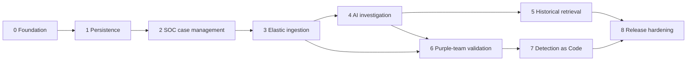

# SentinelForge — Engineering Development Roadmap

**Status:** Phase 2 implemented and locally validated on 2026-10-28; Phase 3 remains planned

**Planning model:** Dependency- and acceptance-driven (not date-driven)  
**Intended audience:** Codex and engineers implementing the platform  
**Architecture reference:** [`ARCHITECTURE.md`](./ARCHITECTURE.md)

> **Rule for Codex:** Implement the current phase in reviewable changes. Do not scaffold an entire future subsystem just because it appears on this roadmap. Each phase is complete only when its exit criteria and tests pass. Update this document as technical decisions are made and link substantive changes to ADRs.

---

## 1. Product outcome

SentinelForge is a **self-hosted, standalone SOC case management and detection validation application** with:

- An alert queue and full investigation/case workflow.
- PostgreSQL-backed case history, evidence, analyst notes, audit trail and historical search.
- Elasticsearch as the first security alert and telemetry provider, behind a source adapter.
- A local Ollama/Qwen triage worker that writes evidence-backed **recommendations**, not autonomous incident dispositions.
- An optional in-app **ATÉ chatbot**, initially using configurable Ollama model `qwen3:8b`, for case-triage questions (Phase 4) and Detection Engineering as Code assistance (Phase 7).
- Optional retrieval of historical analyst-reviewed cases for AI investigations.
- Controlled Atomic Red Team / Caldera tests and independent detection evaluation.
- Rule validation, test fixtures, and approval-gated detection deployment.
- Windows desktop deployment via Docker Compose for application services, with optional Dell R620 isolated attack lab.

### Build philosophy

**Vertical slices over large scaffolds.** Make one workflow complete (database → API → UI → tests) before adding a new infrastructure dependency. Use deterministic synthetic fixtures during early engineering. Keep the application useful with Elastic and Ollama offline.

### Definition of *done* for every phase

A phase is complete when all apply:

1. Described capability works end-to-end on a fresh local deployment.
2. Data persists as expected across container/worker restarts.
3. Unit/integration tests cover happy path, failure path and relevant authorization boundaries.
4. API/docs and migration instructions reflect the implemented behavior.
5. Structured logs and user-facing error states exist for external/long-running operations.
6. No credentials, unsafe live targets, or raw sensitive fixtures are committed.
7. Scope is reviewed; unfinished items are explicit backlog items, not disguised as finished features.

---

## 2. Dependency graph and release slices



**Milestone A — Core SOC MVP:** Phases 0–2. Works entirely with seeded/manual alerts.  
**Milestone B — AI-assisted SOC:** Phases 3–5. End-to-end Elastic → case → local AI → review → historical retrieval.  
**Milestone C — Validation platform:** Phases 6–7. Test execution, detection measurement, controlled rules pipeline.  
**Milestone D — v1.0 release:** Phase 8. Repeatable deployment, observability, security, recovery, and documentation.

Work on security controls, API documentation, and tests continuously rather than postponing them to Phase 8.

---

## Phase 0 — Repository, infrastructure, and contracts

**Goal:** A clean, reproducible development foundation, not a feature-complete SOC.

### Engineering tasks

- [x] Establish monorepo: `apps/web`, `apps/api`, `apps/worker`, `packages/contracts`, `packages/detection-rules`, `tests`, `docs`, `infrastructure`.
- [x] Keep `AGENTS.md`, `docs/ARCHITECTURE.md`, and `docs/ROADMAP.md` aligned; create `docs/ADR/` for decisions.
- [x] Create `compose.yaml` plus a dev override for PostgreSQL, Redis, FastAPI, and the frontend. Elastic/Kibana may be optional Compose profiles for resource-aware startup.
- [x] Keep Ollama **outside** Docker initially on Windows GPU; model endpoint is configurable. Phase 0 tests use deterministic injected health probes/API fixtures; model-provider fakes arrive with Phase 4 (ADR 0001).
- [x] Create `.env.example` with safe placeholders and document secret-loading, host ports, and WSL2 prerequisites.
- [x] Add health and readiness checks. Readiness must distinguish core app availability from optional Elastic/Ollama availability.
- [x] Set up Python quality tooling (formatter, linter, type checker, pytest) and frontend lint/typecheck/test runner.
- [x] Add CI running formatting, type checks, unit tests and build checks; don't require Ollama or real Elastic in CI. Hosted API, web, and infrastructure jobs passed for baseline commit `00c7bf2`.
- [x] Generate OpenAPI from FastAPI and establish frontend contract validation/type generation approach.
- [x] Add seeded **synthetic** security alerts and case fixtures. Static deterministic files only; database seeding awaits Phase 1 tables.
- [x] Create `docs/RUNBOOK.md`: prerequisites, start/stop, reset demo data, logs, troubleshooting, and backup warning.

### Exit criteria

- [x] A fresh clone starts with documented commands and no production credentials. Verified against `00c7bf2` in an isolated Compose project with new volumes and synthetic credentials.
- [x] `GET /api/v1/health` succeeds and a frontend page loads API data. Verified through the Docker API/Nginx stack with a real browser.
- [x] PostgreSQL can accept a migration and retains data through `docker compose down`/`up`. Verified with an isolated synthetic database and post-restart worker smoke.
- [x] CI passes with no GPU, Ollama, Elastic, Windows VM, or R620 dependency. [Baseline hosted run](https://github.com/huntsdev/ate/actions/runs/40444887595) passed all three jobs.
- [x] Stopping the stack does not remove named data volumes; destructive reset is a separate explicit command. Verified by the core persistence check without volume deletion.

**Implementation caution:** Do not implement LLM orchestration, attack execution, or enterprise auth in Phase 0.

Implementation and actual check results: [PHASE_0_STATUS.md](PHASE_0_STATUS.md).
Phase 0 baseline Docker/CI exit criteria are verified. The optional-configuration
follow-up has local source/runtime validation; it has not been pushed or run in
hosted CI. The user subsequently authorized Phase 1; its results are below.
Decisions: [ADR 0001](ADR/0001-phase-0-foundation.md),
[ADR 0002](ADR/0002-frontend-foundation.md),
[ADR 0003](ADR/0003-optional-provider-configuration.md). Phase 3 and later remain unimplemented.

---

## Phase 1 — Domain model, migrations, and auditability

**Goal:** A durable source of truth for SOC cases, imported alerts, and related activity.

### Engineering tasks

- [x] Define enums and validation for case status (`new`, `triaging`, `investigating`, `resolved`, `closed`) and disposition (`true_positive`, `benign_positive`, `false_positive`, `inconclusive`).
- [x] Implement SQLAlchemy models and Alembic migrations for `cases`, `alerts`, `case_alerts`, `evidence`, `case_notes`, `case_events`, and initial `users`/service actors.
- [x] Add UUID primary keys; use immutable human-facing case IDs such as `SF-2026-000142`.
- [x] Add source uniqueness: provider + provider scope + external alert ID.
- [x] Implement many-to-many alert↔case links, explicit source references, evidence timestamps, and optional bounded evidence snapshots.
- [x] Enforce case transition rules; separate case disposition from AI-generated recommendations.
- [x] Add an append-only audit mechanism for status changes, assignments, note edits, linking/unlinking evidence, and case closure/reopening.
- [x] Implement optimistic locking or equivalent conflict detection for concurrent edits.
- [x] Add service/repository tests, transaction rollback checks, and migration upgrade/downgrade tests (where safe).
- [x] Draft `docs/DATA-MODEL.md` with ERD and invariants.

### Exit criteria

- [x] Duplicate external alerts are not stored twice. Verified with concurrent source replay and scope/provider isolation on PostgreSQL.
- [x] Invalid case transitions and invalid dispositions are rejected consistently. Verified pure rules, typed schemas, database constraints and service rollback.
- [x] Audit records show **who**, **what**, and **when** for relevant changes. Actor snapshots, reasons, before/after state, correlation IDs and version order are retained; mutation attempts are rejected.
- [x] Cases, notes, links, and evidence survive restart. Verified complete synthetic graph and all nine audit events across Compose down/up.
- [x] Migration from an empty database works automatically or through a documented command. Verified empty upgrade/downgrade/re-upgrade and the existing Phase 0 deployment upgrade.

Decisions: [ADR 0004](ADR/0004-phase-1-domain-persistence.md).
Schema and internal service boundary: [DATA-MODEL.md](DATA-MODEL.md).
Observed validation: [PHASE_1_STATUS.md](PHASE_1_STATUS.md).
No new hosted CI pass is claimed for these uncommitted changes. Phase 2 has since
added the case APIs and browser workflows described below.

**Avoid:** Putting full raw Elastic event streams into PostgreSQL; store metadata and curated snapshots with source links.

---

## Phase 2 — Full-stack SOC case management MVP

**Goal:** An analyst can complete an investigation entirely through the standalone web application with seeded or manually imported alerts.

### Backend work

- [x] Create/read/update/list/search endpoints for cases with pagination, sorting, filters, and robust validation. Closing/reopening retains history; there is no destructive case delete route.
- [x] Alert browsing and detail endpoints; link/unlink alerts to cases with recorded reasons.
- [x] Notes and evidence timeline endpoints with chronological provenance.
- [x] Case lifecycle actions: assign, begin triage, investigate, resolve with disposition, close, reopen.
- [x] Consistent problem/error schema and request correlation IDs.
- [x] Explicit loopback single-user mode with server-owned local actor, restricted Host/Origin and write token checks. Formal authentication/RBAC remains mandatory before LAN/multiuser use.

### Frontend work

- [x] Responsive application shell, navigation, loading/error/empty states. Complete enterprise-style graphite/mint redesign with shadcn components and a custom brand mark.
- [x] SOC dashboard: open cases, severity mix, recently changed cases; source is app DB.
- [x] Alert queue: search, filter, open details, associate to case.
- [x] Case list: status, severity, owner, source, last activity.
- [x] Case workspace: summary, linked alerts, evidence timeline, notes, audit history, assignment, disposition.
- [x] Distinct visual display of analyst disposition; AI assistance explicitly reports not enabled, without invented assessments.
- [x] Test accessibility basics: keyboard operation, semantic labels, contrast, focus visibility, responsive overflow and dialogs.

### API surface (implemented core routes)

```http
GET    /api/v1/cases
POST   /api/v1/cases
GET    /api/v1/cases/{case_id}
PATCH  /api/v1/cases/{case_id}
POST   /api/v1/cases/{case_id}/transitions
GET    /api/v1/cases/{case_id}/timeline
GET    /api/v1/cases/{case_id}/notes
POST   /api/v1/cases/{case_id}/notes
GET    /api/v1/cases/{case_id}/alerts
POST   /api/v1/cases/{case_id}/alerts
GET    /api/v1/alerts
GET    /api/v1/alerts/{alert_id}
```

### Exit criteria — **first major vertical slice**

```text
Create/import one synthetic alert
  → create a case
  → link the alert
  → inspect a preserved evidence reference
  → add an analyst note
  → assign/resolve with disposition
  → view audited changes
  → restart entire stack
  → reopen the same saved case with its history intact
```

- [x] Entire workflow works in browser without database consoles or manual API calls.
- [x] Browser E2E test covers the vertical slice, including Compose restart and reopening with retained notes/evidence/history on desktop and mobile.
- [x] Invalid user inputs and conflicting edits yield clear recoverable errors. Two-tab browser tests prove draft retention and explicit reload/review before retrying a stale edit.

Implementation choices: [ADR 0005](ADR/0005-phase-2-local-case-workspace.md).
Current routes and contracts: [API.md](API.md).
Observed checks and limits: [PHASE_2_STATUS.md](PHASE_2_STATUS.md).
The implementation remains local-only and synthetic; hosted CI execution of
the current changes is pending a push. Phase 3 ingestion is not implemented.

**Checkpoint:** This is a usable standalone case manager. Do not introduce Ollama until this checkpoint is stable.

---

## Phase 3 — Elasticsearch integration and event correlation

**Goal:** Replace seeded-only ingestion with reliable ingestion of real Elastic Security alerts while preserving provider independence.

### Engineering tasks

- [ ] Implement typed `AlertProvider` contract and fake provider from Phase 0 fixtures.
- [ ] Build Elastic adapter with read-only API key, supported alert aliases, bounded paginated queries, and normalized alert mapping.
- [ ] Add integration config/health page without revealing secrets.
- [ ] Implement durable polling cursor/watermark and overlap window; commit cursor after writes and downstream scheduling are durable.
- [ ] Handle source clock skew, late alerts, schema variance, and malformed records without stopping all ingestion.
- [ ] Design a normalized alert schema: source, scope, external ID, rule metadata, event/import times, severity, host/user/process identifiers, ATT&CK metadata, original reference.
- [ ] Implement deduplication/upsert and idempotent reprocessing.
- [ ] Implement bounded evidence-enrichment queries (process ancestry, parent/child activity, neighboring network/auth events) using allowlisted fields and time windows.
- [ ] Add deterministic correlation suggestions based on process entity ID, host, user, rule family, event time, and other verified signals. Track confidence and reasons.
- [ ] Allow analyst correction of erroneous grouping; do not forcibly merge unrelated alerts due to proximity alone.
- [ ] Add queue metrics for ingestion lag, skipped/invalid alerts, duplicates and source downtime.

### Exit criteria

- [ ] A test Elastic detection produces an alert visible in SentinelForge.
- [ ] Restarting the worker does not duplicate previously imported alerts.
- [ ] Provider outage raises a degraded status, preserves the last cursor, and retries safely.
- [ ] Evidence queries are read-only and bounded; source Elastic alerts remain unchanged.
- [ ] Correlation reasons are visible and reviewable in case history.
- [ ] A fake provider can substitute for Elastic with no domain rewrite.

**Security gate:** Never grant the ingestion API key rule-edit, alert-write, or administrative permissions.

---

## Phase 4 — Local LLM triage and investigation automation

**Goal:** Provide evidence-grounded, structured AI triage without compromising control of the investigation.

### Engineering tasks

- [ ] Implement `ModelProvider` protocol, `FakeModelProvider`, and Ollama REST adapter.
- [ ] Benchmark candidate quantized Qwen models on RTX 4070 Ti with explicit context size, concurrency, latency and VRAM measurements. Record selection in an ADR.
- [ ] Add `triage_runs`, `triage_findings`, `jobs`, and `analyst_reviews` persistence and migrations.
- [ ] Implement Redis-backed job queue (select RQ **or** Celery), retries, timeouts, per-case idempotency, and visible failure states.
- [ ] Build enrichment/context assembly with strict event-count, time, byte, and token budgets. Store the exact evidence IDs used.
- [ ] Define JSON Schema / Pydantic output: classification, severity, findings with evidence IDs, missing evidence, recommended actions, and review flag.
- [ ] Validate schema and every cited ID. Flag unsupported claims/outputs; expose uncertainty/abstention.
- [ ] Persist model, model version/quantization, prompt template version, inference settings, latency, source evidence IDs, and analyst feedback.
- [ ] Develop the case UI for triage queueing, in-progress states, generated findings, evidence links, approval/rejection and correction.
- [ ] Make offloaded/Ollama-unavailable states recoverable: queue work for later without blocking case management.
- [ ] Implement prompt-injection tests with adversarial strings embedded in logs. Keep provider tools read-only and allowlisted.
- [ ] Prepare a frozen, analyst-labeled case benchmark and score classification quality, abstention, citation validity, and unsupported claims.

### Optional ATÉ chatbot — case triage

This is a planned native ATÉ feature, not a dependency on Open WebUI. Introduce
it as an opt-in capability; ordinary case management and structured triage must
remain usable with the chatbot disabled or Ollama offline.

- [ ] Add an accessible chatbot panel in the ATÉ case workspace for follow-up questions, evidence explanations, missing-context questions, and suggested investigation steps.
- [ ] Use `qwen3:8b` as the initial configurable model through the existing backend `ModelProvider`/Ollama adapter. Share bounded inference scheduling with triage; start with one GPU request at a time and benchmark context/VRAM use before enabling it.
- [ ] Scope each conversation to the analyst-selected case and authorized evidence. Case-specific claims must cite supplied evidence IDs; separate general guidance, inference, and unknowns. Never invent access to telemetry or other cases.
- [ ] Design conversation/message persistence, model/prompt provenance, evidence references, retention/redaction, and migrations during Phase 4. Keep chat separate from authoritative case notes, disposition, and structured triage reports; saving an answer as a note requires explicit analyst action and audit logging.
- [ ] Bound message/history/context sizes, validate requests and citations, treat case evidence and chat content as untrusted input, and provide visible loading, cancellation, timeout, and offline states.
- [ ] Keep the chatbot advisory: no arbitrary shell/SQL execution, remediation, case closure/disposition changes, simulation execution, detection approval, or deployment. Any proposed changes remain drafts for human review.
- [ ] Add deterministic fake-provider/API/browser tests for grounded answers, invalid citations, cross-case access denial, prompt injection, disabled mode, offline behavior, and inference limits; evaluate live Qwen responses separately.

### Exit criteria

- [ ] From a real or synthetic alert: enrichment → Ollama request → validated assessment → saved case report → analyst review.
- [ ] AI cannot change case disposition, close cases, execute scripts, deploy rules, or perform containment.
- [ ] Every cited evidence ID is traceable; invalid citations are rejected or explicitly flagged.
- [ ] With Ollama offline, the UI remains available and the investigation waits/retries without data loss.
- [ ] Same seeded fixture and prompt revision support deterministic *contract* tests; live model outputs are assessed probabilistically with tolerant semantic metrics.
- [ ] When the optional chatbot is enabled, an analyst can ask a selected case's triage question, inspect evidence citations and uncertainty, and retain conversation provenance. Disabled/offline chat does not block cases; chat cannot bypass case permissions or change authoritative records autonomously.

**Key distinction:** A model suggestion is never authoritative ground truth.

---

## Phase 5 — Historical case intelligence and retrieval

**Goal:** Use reviewed prior investigations as reference material, with provenance and relevance scoring.

### Engineering tasks

- [ ] Introduce structured metadata filters and PostgreSQL full-text search for case history.
- [ ] Define a canonical, redacted historical-case summary: findings, verified indicators, material context, disposition, analyst rationale, exclusions and evidence references.
- [ ] Define eligibility: only analyst-reviewed, complete cases enter default AI retrieval; draft/AI-only cases excluded by default.
- [ ] Add separate embedding generation with versioned embedding model and deterministic text hashing.
- [ ] Enable `pgvector` and indexing; tune hybrid lexical/vector retrieval against labeled similar/dissimilar cases.
- [ ] Return retrieved case IDs, relevance scores and supporting fields for analyst inspection.
- [ ] Incorporate top-K reviewed cases into bounded triage context as untrusted reference documents.
- [ ] Compare new evidence with prior cases; generate **similarities and differences**, not automatic disposition inheritance.
- [ ] Record which historical cases were retrieved and what changed following analyst feedback.
- [ ] Build library UI for historical search, filters, and opening archived evidence/case reviews.
- [ ] Evaluate retrieval relevance, model answer grounding, and effect on triage correctness versus a no-RAG baseline.

### Exit criteria

- [ ] Historical cases can be searched by metadata and text independent of the LLM.
- [ ] Semantic retrieval identifies relevant prior cases without returning unreviewed/unauthorized records.
- [ ] AI assessment identifies specific prior case IDs and significant differences.
- [ ] No new case is auto-closed or automatically labeled benign from a historical match.
- [ ] Re-indexing after changing embedding models is versioned and repeatable.

---

## Phase 6 — Purple-team test orchestration and detection validation

**Goal:** Generate controlled adversary-like behavior and independently measure telemetry, rule detection, and AI interpretation.

### Engineering tasks

- [ ] Create a simulation registry: test ID, ATT&CK ID, description, prerequisites, allowlisted target, expected events, expected rules, cleanup procedures.
- [ ] Implement execution adapters beginning with **Atomic Red Team**; integrate Caldera later once the executor contract works.
- [ ] Require explicit operator authorization, target allowlisting, timeouts, isolation, and cleanup validation before execution.
- [ ] Record immutable simulation metadata: operator, target, run ID, technique, execution start/end, return status, actual artifacts.
- [ ] Capture expected event signatures and rule IDs without revealing simulation ground truth to AI triage context.
- [ ] Correlate events with simulation using target, event time, rule version and process identifiers, avoiding time-only matches.
- [ ] Implement outcome engine: `passed`, `detection_gap`, `telemetry_gap`, `invalid_test`, `inconclusive`.
- [ ] Add benign control tests to estimate false positives and noisy rules.
- [ ] Expose detection coverage, telemetry completeness, alert latency, AI classification performance and technique distribution.
- [ ] Link simulation run → collected telemetry → Elastic alerts → SentinelForge case → reviewed AI result.
- [ ] Build repeatable local synthetic integration tests before running live isolated endpoint tests.

### Exit criteria

- [ ] One allowlisted Atomic test runs safely on an isolated target, produces a run record and performs cleanup.
- [ ] System differentiates missed detection from missing telemetry and failed execution.
- [ ] Validation evidence links are retained and reproducible.
- [ ] AI never receives the expected classification or known malicious/test ground truth during triage.
- [ ] Unauthorized targets or out-of-policy operations are rejected by executor, not merely UI.

---

## Phase 7 — Detection Engineering as Code

**Goal:** Treat detection rules as versioned, testable, reviewable engineering artifacts.

### Engineering tasks

- [ ] Define canonical detection rule metadata: stable ID, title, rationale, ATT&CK mapping, required telemetry, author, revision, validation status.
- [ ] Store Sigma and/or native Elastic rule files in Git with fixtures, expected hits, and expected nonhits.
- [ ] Implement static schema checks and target-specific query validation.
- [ ] Implement replay/regression tests over frozen labeled telemetry datasets.
- [ ] Integrate simulation outcomes and rule coverage reports from Phase 6.
- [ ] Add AI-assisted rule drafting as a **proposal** only; never automatically enable generated detections.
- [ ] Implement approval workflow and least-privilege deployment adapter using supported Kibana APIs.
- [ ] Record rule deployment ID, target environment, deployed revision, operator approval and rollback path.
- [ ] Add dashboard: rule health, false positives, missed techniques, version drift and validation history.
- [ ] Ensure CI can run without live Elastic and that live deployment is a separately authorized action.

### Optional ATÉ chatbot — detection assistance

Extend the Phase 4 chatbot when the Phase 7 detection contracts and validation
pipeline exist; do not implement detection workflows during the chat foundation.

- [ ] Let analysts ask the chatbot to explain a selected rule, draft Sigma/native Elastic rule proposals, suggest telemetry requirements and ATT&CK mappings, and propose positive/negative test fixtures.
- [ ] Ground rule-specific answers in the authorized selected rule revision, supported schemas, case evidence, and recorded validation results. Cite source references and distinguish suggestions from measured coverage or validated detection behavior.
- [ ] Show generated rule changes as reviewable drafts/diffs. Explicit human action may submit a proposal to the normal static/replay validation workflow; the chatbot cannot commit, approve, enable, or deploy rules automatically.
- [ ] Test invalid rule generation, unsupported coverage claims, prompt injection in rule/evidence content, and attempts to bypass validation, permissions, or approval gates.

### Exit criteria

- [ ] A new candidate rule fails CI if syntax/contract checks or known-positive/negative tests fail.
- [ ] Rules cannot be deployed without recorded approval.
- [ ] Deployment and rollback are auditable and testable.
- [ ] A rule's reported coverage points to actual test outcomes, not inferred ATT&CK tags alone.
- [ ] When chatbot detection assistance is enabled, a proposed rule or revision follows the same validation and human-approval gates as a manually authored rule; failed validation or missing approval prevents promotion/deployment.

---

## Phase 8 — Security hardening, reliability, and v1.0 release

**Goal:** Make the platform trustworthy, maintainable, and reproducible on a developer workstation.

### Security and access control

- [ ] Enforce authentication and server-side RBAC for analysts/admins (with OIDC extension path).
- [ ] Implement secret management practices, HTTP security, CSRF/session considerations, audit events, and rate limiting.
- [ ] Formalize threat model, especially log-origin prompt injection, historical retrieval poisoning, credential exposure, and simulation executor privilege boundaries.
- [ ] Verify sanitization and redaction of sensitive evidence and protected export paths.
- [ ] Enforce least-privilege networks and service accounts; Ollama API must not be publicly reachable.

### Reliability and operations

- [ ] Add structured API/worker logging and metrics for ingest lag, model performance, job retries, case operation failures, and simulation results.
- [ ] Add synthetic health tests and degraded-service banners for Elastic and Ollama outages.
- [ ] Implement retention and cleanup jobs for evidence excerpts, Elastic indices, embeddings, job logs and PCAPs.
- [ ] Implement PostgreSQL backup **and tested restore**; document which artifacts remain when source telemetry expires.
- [ ] Test restarts during ingestion, during a triage job, and during simulation result processing.
- [ ] Profile RAM/VRAM/disk use on target desktop; document practical resource budgets and startup profiles.
- [ ] Add release versioning, migrations, upgrade/rollback procedures, demo seed data, and documentation site/README.

### Release acceptance scenario

```text
1. Start SentinelForge on Windows with Docker Compose.
2. Sign in and create/review a synthetic case even if Elastic/Ollama are offline.
3. Connect a test Elastic instance with least-privilege credentials.
4. Import an alert once; restarting ingestion must not duplicate it.
5. Enrich the alert and associate evidence with a case.
6. Enable Ollama on the RTX 4070 Ti and request AI triage.
7. Inspect cited evidence, missing context, and proposed next actions.
8. Retrieve historical analyst-reviewed cases and document differences.
9. Have an analyst resolve and close the case; audit history persists.
10. Execute one authorized, isolated Atomic test and validate detection outcome.
11. Stop all services; restart; all records and queued work remain consistent.
12. Restore PostgreSQL from documented backup into a clean environment.
```

- [ ] Each scenario above is demonstrated and documented.
- [ ] Security tests, schema migrations, browser E2E tests, provider contract tests and CI pass.
- [ ] README includes architecture, prerequisites, known limitations, deployment profiles, and screenshots.

---

## 3. Cross-cutting engineering workstreams

These run alongside every phase:

| Workstream | Ongoing requirements |
|---|---|
| **Security** | Threat modeling, strict trust boundaries, least-privilege adapters, auditability |
| **Testing** | Unit, provider contract, integration, browser E2E, fault injection and labeled evaluation |
| **Data governance** | UTC timestamps, provenance, data classification, retention, redaction, backup |
| **Developer experience** | Typed schemas, reproducible fixtures, Compose, CI, concise runbooks |
| **Performance** | Bounded data queries, CPU/GPU concurrency, indexing and storage profiling |
| **Documentation** | ADRs, current API, data model, operational runbook, known limitations |
| **Usability** | Clear case-vs-alert separation, role-specific actions, accessible state feedback |

### Suggested merge/PR checklist

- [ ] Clear feature scope and testable acceptance criteria.
- [ ] Database migration present if persistence changed.
- [ ] API/client contracts updated and compatible.
- [ ] Happy path, failure path and retry/idempotency tested.
- [ ] Security review performed for new external inputs or credentials.
- [ ] Logging/metrics don't disclose sensitive event data.
- [ ] Documentation/runbook updated for configuration changes.

---

## 4. Prioritized initial engineering backlog

These are the first coherent development units Codex should execute **in sequence**, not all at once.

| Order | Work item | Output / validation |
|---:|---|---|
| 1 | Initialize monorepo and toolchains | API/web build, lint and tests run |
| 2 | Minimal Compose stack | Postgres, Redis, API, UI + persisted volumes |
| 3 | Environment config and health contracts | Safe `.env.example`, core vs. optional health |
| 4 | Schema and migration foundation | `cases`, `alerts`, `case_alerts`, `case_events` |
| 5 | Seeded alert + case service layer | Deterministic fixture, unit and integration tests |
| 6 | Case API and generated frontend types | OpenAPI + CRUD/status validation |
| 7 | Case list/detail and note workflow UI | Browser E2E vertical slice |
| 8 | Restart and migration regression tests | Saved cases and audit survive Compose down/up |
| 9 | Elastic adapter + cursor | Read-only ingestion, deduplication on restart |
| 10 | Evidence retrieval + correlation | Bounded queries and explanation records |
| 11 | Ollama provider + triage schema; optional case chatbot | Offline queue, validated evidence citations, bounded case-scoped Q&A with human authority preserved |
| 12 | Historical search and retrieval | Versioned, reviewed case retrieval |
| 13 | Simulation registry / validation | Ground truth separation and clear verdicts |
| 14 | Rule testing/promotion; optional chatbot detection assistance | CI validation, reviewable AI draft rules/tests, and human approval gates |

### First Codex implementation prompt

> Read `AGENTS.md` (if present), `docs/ARCHITECTURE.md`, and `docs/ROADMAP.md`. Implement **Phase 0 only**. First inspect the repository and summarize any existing structure or conflicting decisions. Create a minimal, functioning Docker Compose development environment, a FastAPI health endpoint, a React UI that consumes it, configuration examples, deterministic test fixtures, and baseline tests/CI. Do not implement Elastic ingestion, Ollama integration, or attack simulation yet. Run tests and report files changed, commands run, known limitations, and whether each Phase 0 acceptance criterion passes.

### First product milestone prompt (after Phase 0–1)

> Implement the **Phase 2 case-management vertical slice** using the Phase 1 schema. From a seeded synthetic alert, an analyst must be able to create/open a case, link the alert, add a note, resolve it with a disposition, see the append-only audit history, restart services, and retrieve the same persisted case. Include API contract tests, database integration tests, and one browser E2E test. Do not integrate live Elastic or Ollama in this change.

---

## 5. Architecture decisions and future extensions

### Decide and document before implementation

- [ ] Background jobs: RQ vs. Celery.
- [ ] Frontend routing/component library and client state patterns.
- [ ] Local auth development mode versus authenticated LAN mode.
- [ ] Elastic version compatibility and source alert alias strategy.
- [ ] Qwen model/version/quantization after VRAM and latency benchmarking.
- [ ] Optional ATÉ chatbot: frontend placement, conversation API/persistence and retention, case/rule access boundaries, and shared inference scheduling. Initial model is configurable `qwen3:8b`; case Q&A starts in Phase 4 and detection assistance extends it in Phase 7.
- [ ] Evidence retention, redaction and export restrictions.

### Deliberately deferred until the core platform is stable

- Additional SIEM/EDR adapters (SentinelOne, Wazuh, Microsoft Sentinel).
- Multi-tenant organization isolation, advanced analyst permissions and SSO federation.
- More advanced case correlation algorithms and graph-based investigations.
- Model fine-tuning and automated feedback-based optimization.
- Active response actions, which would require a separate, explicit approval model and threat review.
- Enterprise-scale cluster deployment and high-availability architecture.

**Project success criterion:** SentinelForge is not merely an LLM front end for Elasticsearch. It is a durable investigation system that can explain **what happened, what evidence exists, what remains unknown, how a detection performed, what the AI recommended, and what an analyst ultimately decided**.
